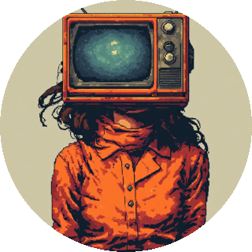

<h1 align="center">RITA</h1>
<h3 align="center">Remote Interface for Total Autonomy</h3>

<i>A DREAM Robotics Remote</i>

 

  

  
  
  
  

---

- Type: Handheld remote (RIFT in your hand)

RITA is a 3.5" touch screen that shows the DREAM Robotics fleet and talks to it through [RIFT](https://github.com/CursedPrograms/RIFT): every robot online, what each one says about itself, and a button for everything it can do.

---

## Related Projects

<table>
  <tr>
    <td align="center"><a href="https://github.com/CursedPrograms/ARIA-Robot-v00"> ARIA</a></td>
    <td align="center"><a href="https://github.com/CursedPrograms/KIDA-Robot-v01"> KIDA-01</a></td>
    <td align="center"><a href="https://github.com/CursedPrograms/KIDA-Robot-v00"> KIDA-00</a></td>
    <td align="center"><a href="https://github.com/CursedPrograms/WHIP-Robot-v00"> WHIP</a></td>
    <td align="center"><a href="https://github.com/CursedPrograms/NORA-Robot-v00"> NORA</a></td>
    <td align="center"><a href="https://github.com/CursedPrograms/MILA-Robot-v00"> MILA</a></td>
    <td align="center"><a href="https://github.com/CursedPrograms/NIKA-Robot-v00"> NIKA</a></td>
  </tr>
  <tr>
    <td align="center"><a href="https://github.com/CursedPrograms/IDA-Robot-v00"> IDA</a></td>
    <td align="center"><a href="https://github.com/CursedPrograms/ARM-Robot-v01"> ARM</a></td>
    <td align="center"><a href="https://github.com/CursedPrograms/DREAM"> DREAM</a></td>
    <td align="center"><a href="https://github.com/CursedPrograms/RIFT"> RIFT</a></td>
    <td align="center"><a href="https://github.com/CursedPrograms/NINA"> NINA</a></td>
    <td align="center"><a href="https://github.com/CursedPrograms/TINA"> TINA</a></td>
  </tr>
</table>

---

## Overview

<b>Overview</b>

### What she does
- [x] **Splash**: her TV-head avatar for 5 s at power-up.
- [x] **Home**: every robot she drives, its round avatar with its name under it: WHIP, NORA, MILA, NIKA, KIDA-00, KIDA-01, IDA, ARM and ARIA. The ones on the network have a green ring; the rest are dimmed.
- [x] **A controller for each robot**: tap one and drive it, talking to the robot directly (its own web API, the one its PC controller uses). Hold a pad button to drive, let go and it stops. Each robot gets its own pad and buttons:
  - **WHIP** (hexapod): W / A / S / D with curves, crab left / right, HELLO, DANCE, REST, AUTO, CRAB - / + (his crab offset, a degree a press).
  - **ARIA** (drone): her state, battery and network, and the fleet's phrases. No flying: she flies from her app or a gamepad.
  - **NORA** (mecanum): A / D slide, diagonals slide, TURN L / R, AUTO, UV, music, her wheel lock.
  - **MILA, NIKA, KIDA-00, KIDA-01** (tracks): **WASD** or **TANK**, switched at the top. The controls change, and so does the robot's own drive mode. The screen takes one finger at a time, so in TANK the tracks latch: tap the left track's FWD / STOP / BACK, then the right's, and each keeps going until you change it. LINK moves both together; the big STOP stops both.
  - **IDA** (no WiFi): through NORA's IR link.
  - **ARM** (no WiFi): driven from her PC over USB, so RITA just says so.
- [x] **RIFT too**: from a controller, RIFT: ASK / DO shows what the robot says about itself through RIFT and everything RIFT can do with it, as 1 s timed moves that ask *"Let RITA move NORA?"* first.
- [x] **Safety stays with the robots**: their own stops (walls, tilt, the wheel locks) still hold. Their PIN (`ROBOT_PIN` in `secrets.h`) signs RITA in as a controller; unlocking wheels is its own button (UNLOCK).
- [x] **The fleet's WiFi ladder**: she joins the highest network she can see (RIFT, DREAM, NINA, TINA, the controllers, NORA), looks again every minute, and starts over when hers goes quiet. She registers with the hub as `RITA` (type `remote`).
- [x] **LED**: green on RIFT's network, amber on another one (the list works, ask and do need RIFT), red with no network.

### Later
- [ ] Host the fleet herself when there's no RIFT (a place on the WiFi ladder).
- [ ] RIFT's music together, the mission log and the robots' conversations.
- [ ] Start a robot's MIND mode from her (through its PC controller).

---

## Prerequisites

<b>Hardware</b>

| Part | Notes |
| :--- | :--- |
| **ESP32-3248S035R** | The 3.5" "Cheap Yellow Display": ESP32, 480x320 ST7796 screen, XPT2046 resistive touch, RGB LED, SD slot, speaker connector |
| **USB cable** | Power and flashing (micro-USB or USB-C, depending on the board revision) |

<b>Software</b>

- [Arduino IDE](https://docs.arduino.cc/software/ide/) (or arduino-cli) with the **esp32** board package (3.x)
- Libraries: **LovyanGFX**, **ArduinoJson** (7.x)

---

## Pinouts

<b>ESP32-3248S035R</b>

| Part | Pins |
| :--- | :--- |
| ST7796 screen (HSPI) | SCLK 14, MOSI 13, MISO 12, DC 2, CS 15, backlight 27 |
| XPT2046 touch (same bus) | CS 33, IRQ 36 |
| RGB LED (active low) | R 4, G 16, B 17 |

Negative colours? Flip `PANEL_INVERT` in `scripts/esp32/display.h`. Red and blue swapped? `PANEL_BGR`.

---

## How to Run

<b>View How to Run</b>

1. Copy `scripts/esp32/secrets.example.h` to `secrets.h` and put in the fleet's WiFi passwords (the same as every robot's).
2. Flash her: `flash.bat` (on a fresh PC it installs the Arduino command line tool, the ESP32 board package and her libraries by itself, then finds the port, compiles and flashes, talking you through it), or open `scripts/esp32/esp32.ino` in the Arduino IDE with **ESP32 Dev Module** and the **Huge APP** partition scheme.
3. On the first boot, tap each corner as it lights up (touch calibration, kept in flash). Hold the screen while she starts to calibrate again.
4. She finds the fleet's network by herself. Tap a robot to see it and drive it.

---

&copy; Cursed Entertainment 2026

  

---

<!-- DREAM-ECOSYSTEM:START -->
## The DREAM Robotics ecosystem

**Minds** — [DREAM](https://github.com/CursedPrograms/DREAM) companion · [TINA](https://github.com/CursedPrograms/TINA) engineer · [NINA](https://github.com/CursedPrograms/NINA) caretaker · [RIFT](https://github.com/CursedPrograms/RIFT) fleet hub · [LYCEA](https://github.com/CursedPrograms/LYCEA) training school  
**Robots** — [NORA](https://github.com/CursedPrograms/NORA-Robot-v00) · [MILA](https://github.com/CursedPrograms/MILA-Robot-v00) · [WHIP](https://github.com/CursedPrograms/WHIP-Robot-v00) · [KIDA-00](https://github.com/CursedPrograms/KIDA-Robot-v00) · [KIDA-01](https://github.com/CursedPrograms/KIDA-Robot-v01) · [IDA](https://github.com/CursedPrograms/IDA-Robot-v00) · [ARM](https://github.com/CursedPrograms/ARM-Robot-v01) · [NIKA](https://github.com/CursedPrograms/NIKA-Robot-v00) · [ARIA](https://github.com/CursedPrograms/ARIA-Robot-v00)  
**Remotes** — [RITA](https://github.com/CursedPrograms/RITA) handheld remote  
<!-- DREAM-ECOSYSTEM:END -->
