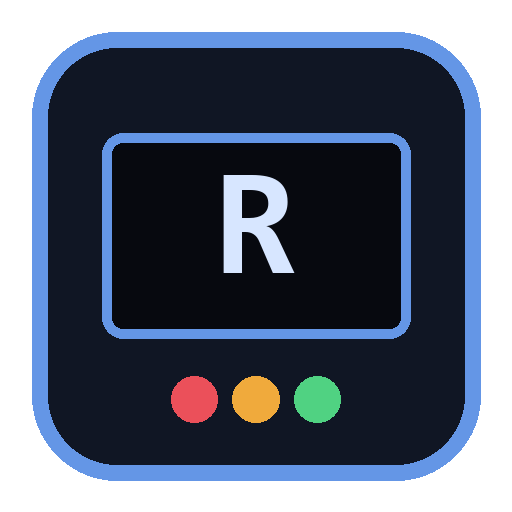

  
 

  

  

  
  

  

# RITA
## Remote Interface for Total Autonomy

- Type: Handheld remote (RIFT in your hand)

RITA is a 3.5" touch screen that shows the DREAM Robotics fleet and talks to it through [RIFT](https://github.com/CursedPrograms/RIFT): every robot online, what each one says about itself, and a button for everything it can do.

---

## Related Projects

- [RIFT](https://github.com/CursedPrograms/RIFT)
- [NORA-Robot-v00](https://github.com/CursedPrograms/NORA-Robot-v00)
- [WHIP-Robot-v00](https://github.com/CursedPrograms/WHIP-Robot-v00)
- [KIDA-Robot-v01](https://github.com/CursedPrograms/KIDA-Robot-v01)
- [DREAM](https://github.com/CursedPrograms/DREAM)

---

## 📖 Overview

<b>Overview</b>

### What she does
- [x] **Fleet**: every robot online, from RIFT's `/fleet` (or the `/robots` list of whoever hosts the network). Busy robots are outlined in amber.
- [x] **Robot**: tap one to see what it says about itself (RIFT's *ask*: mode, moving, music, distances) and get a button for every action it has (RIFT's *do*). Harmless actions (music, lights, UV, stop, photo...) are green; moving ones are amber.
- [x] **Moving asks first**: the first moving action on a robot asks *"Let RITA move NORA?"*. After a yes, each tap is a 1 s timed move (RIFT caps them at 3 s). A drive pad appears for robots that drive.
- [x] **Safety stays with the robots**: their own stops (walls, tilt, NORA's lock) still hold, and RIFT never passes on anything that unlocks a robot.
- [x] **The fleet's WiFi ladder**: she joins the highest network she can see (RIFT, DREAM, NINA, TINA, the controllers, NORA), looks again every minute, and starts over when hers goes quiet. She registers with the hub as `RITA` (type `remote`).
- [x] **LED**: green on RIFT's network, amber on another one (the list works, ask and do need RIFT), red with no network.

### Later
- [ ] Host the fleet herself when there's no RIFT (a place on the WiFi ladder).
- [ ] RIFT's music together, the mission log and the robots' conversations.
- [ ] Start a robot's MIND mode from her (through its PC controller).

---

## Prerequisites

<b>Hardware</b>

| Part | Notes |
| :--- | :--- |
| **ESP32-3248S035R** | The 3.5" "Cheap Yellow Display": ESP32, 480x320 ST7796 screen, XPT2046 resistive touch, RGB LED, SD slot, speaker connector |
| **USB cable** | Power and flashing (micro-USB or USB-C, depending on the board revision) |

<b>Software</b>

- [Arduino IDE](https://docs.arduino.cc/software/ide/) (or arduino-cli) with the **esp32** board package (3.x)
- Libraries: **LovyanGFX**, **ArduinoJson** (7.x)

---

## ⚡ Technical Pinouts

<b>ESP32-3248S035R</b>

| Part | Pins |
| :--- | :--- |
| ST7796 screen (HSPI) | SCLK 14, MOSI 13, MISO 12, DC 2, CS 15, backlight 27 |
| XPT2046 touch (same bus) | CS 33, IRQ 36 |
| RGB LED (active low) | R 4, G 16, B 17 |

Negative colours? Flip `PANEL_INVERT` in `scripts/esp32/display.h`. Red and blue swapped? `PANEL_BGR`.

---

## How to Run:

<b>View How to Run</b>

1. Copy `scripts/esp32/secrets.example.h` to `secrets.h` and put in the fleet's WiFi passwords (the same as every robot's).
2. Flash her: `flash.bat` (finds the port, compiles and flashes, talking you through it), or open `scripts/esp32/esp32.ino` in the Arduino IDE with **ESP32 Dev Module** and the **Huge APP** partition scheme.
3. On the first boot, tap each corner as it lights up (touch calibration, kept in flash). Hold the screen while she starts to calibrate again.
4. She finds the fleet's network by herself. Tap a robot to see it and drive it.

---

 

&copy; Cursed Entertainment 2026

 

---

<!-- DREAM-ECOSYSTEM:START -->
## The DREAM Robotics ecosystem

**Minds** — [DREAM](https://github.com/CursedPrograms/DREAM) companion · [TINA](https://github.com/CursedPrograms/TINA) engineer · [NINA](https://github.com/CursedPrograms/NINA) caretaker · [RIFT](https://github.com/CursedPrograms/RIFT) fleet hub · [LYCEA](https://github.com/CursedPrograms/LYCEA) training school  
**Robots** — [NORA](https://github.com/CursedPrograms/NORA-Robot-v00) · [MILA](https://github.com/CursedPrograms/MILA-Robot-v00) · [WHIP](https://github.com/CursedPrograms/WHIP-Robot-v00) · [KIDA-00](https://github.com/CursedPrograms/KIDA-Robot-v00) · [KIDA-01](https://github.com/CursedPrograms/KIDA-Robot-v01) · [IDA](https://github.com/CursedPrograms/IDA-Robot-v00) · [ARM](https://github.com/CursedPrograms/ARM-Robot-v01)  
**Remotes** — [RITA](https://github.com/CursedPrograms/RITA) handheld remote  
**Tools** — [CRUSH](https://github.com/CursedPrograms/CRUSH) compression · [Image-Generator](https://github.com/CursedPrograms/Image-Generator) · [GloriosaAI](https://github.com/CursedPrograms/GloriosaAI) · [SynthWomb](https://github.com/CursedPrograms/SynthWomb) · [PyVitals](https://github.com/CursedPrograms/PyVitals)  
<!-- DREAM-ECOSYSTEM:END -->
